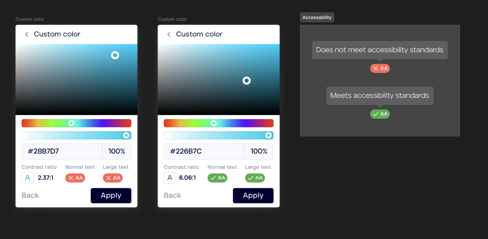
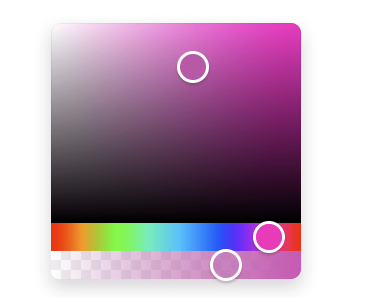
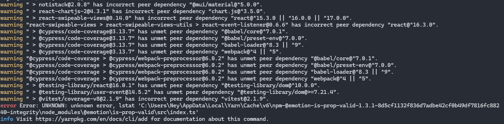

# AD-01: Color Picker component

- _Date_: 21.03.2025
- _Driver_: Neycho Neychev
- _Stakeholders_: Eva Peiker, Santosh Dhirwani
- _Status_: PROPOSED
- _Categories_: FE, Color Picker functionality
- _Outcome_: <OUTCOME - once decided, provide a short summary of the decision
  outcome here>

## Context

We like to create a color Picker component that we can use to set different
colors and check does the contrast meet accessibility standard

- We would like to have a color picker package to be used instead of building
  out own solution
- The package should be able to be extended with external fields and ui element
  to give more information in the UI

- Contrast accessibility standards check

## Alternatives

### Alternative 1

Use https://www.npmjs.com/package/react-colorful for the color picker specific
component

Extending the functionality would be the custom wrapper (popper) that will use
react-colorful and add the missing ui elements from the design

The solution will be extended for the contrast ratio with another package for
validating for the accessibility standard such
as (https://github.com/hkosiacki/react-contrast-picker
or https://www.npmjs.com/package/wcag-contrast-utils).

_Pros:_

- Separating the solution to use multiple packages will give us more control
  over the entire component
- Are not using a fully built package component that would potentially need to
  be changed if it does not satisfy future scopes
- Updating the design would be easier

_Cons:_

- Will need to maintain the custom component
- From development: Had to force NPM to install package. Yarn did not want to
  add the package

## Decision

The decision was made in favor for **alternative X**.

After stating the decision, briefly explain the motivation that led to choosing
the alternative (e.g., by stating which arguments were most important to the
team).

## Consequences

- We will need to maintain and test the custom wrapper.
- Easier adaptability to future design changes.
- Clear separation of responsibilities between UI and accessibility logic.
